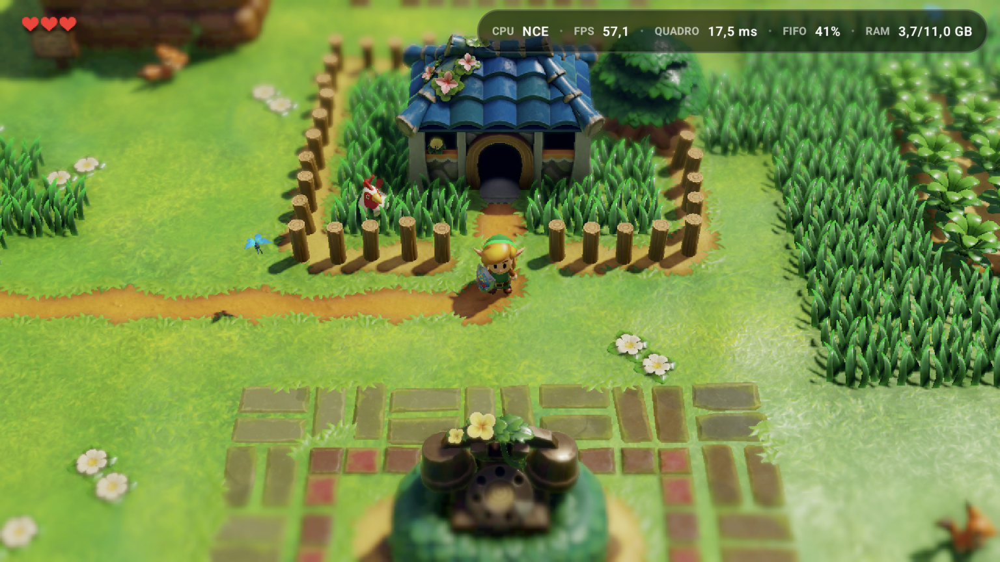
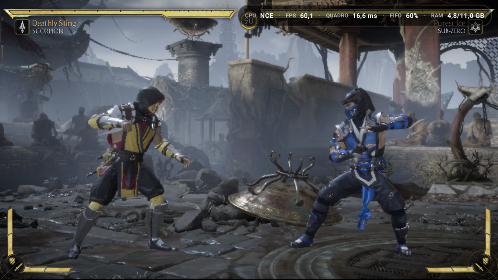
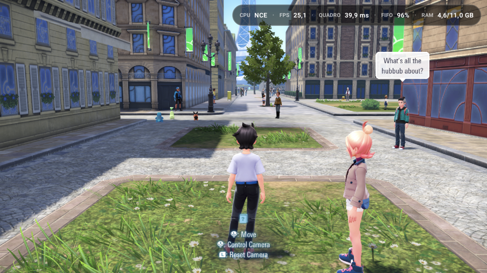
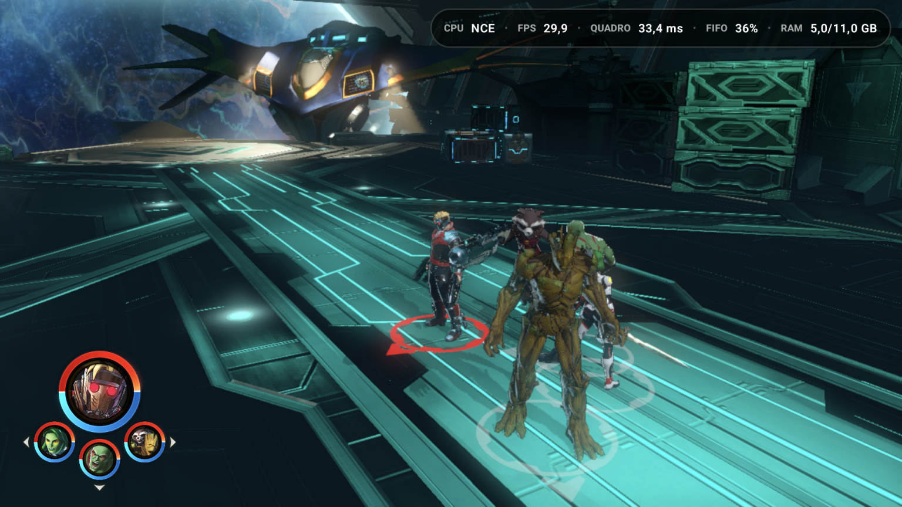

  <picture>
    <source media="(prefers-color-scheme: dark)" srcset="Imagens/Ryujinx%20Neo%20Logo.png">
    
  </picture>

  <h1>Ryujinx Neo</h1>
  
<strong>Um projeto pessoal e experimental de emulação de Nintendo Switch para Android.</strong>

> [!IMPORTANT]
> Este é um fork independente. Não é uma versão oficial do Ryujinx, do Kenji-NX, do Ryubing ou do Eden e não tem vínculo com a Nintendo. O projeto não inclui jogos, firmware, chaves ou conteúdo protegido de terceiros.

## Galeria de jogos

Capturas reais dos meus testes do Ryujinx Neo no Android com jogos que não funcionavam no Eden no meu aparelho. O FPS mostrado em cada imagem é uma leitura instantânea, não uma média de desempenho.

<table>
  <tr>
    <td width="50%" align="center"></td>
    <td width="50%" align="center"></td>
  </tr>
  <tr>
    <td width="50%" align="center"></td>
    <td width="50%" align="center"></td>
  </tr>
  <tr>
    <td width="50%" align="center"></td>
    <td width="50%" align="center"></td>
  </tr>
  <tr>
    <td width="50%" align="center"></td>
    <td width="50%" align="center"></td>
  </tr>
  <tr>
    <td width="50%" align="center"></td>
    <td width="50%" align="center"></td>
  </tr>
</table>

**DOOM (2016)** é um caso especial: o Kenji-NX não iniciava o jogo e, nos meus testes, o Eden não renderizava suas texturas. No Neo, a cena aparece renderizada no registro acima.

## Por que o projeto nasceu

O Ryujinx Neo começou por um motivo simples e pessoal: eu queria jogar alguns títulos que, no meu aparelho e na versão do Eden que eu utilizava, não rodavam como eu precisava. A linha Android do Kenji-NX oferecia outro caminho técnico. Passei a estudá-la, testar hipóteses e adaptar o código para os jogos e dispositivos que tenho à mão.

O nome **Neo** representa esse trabalho de evolução experimental: ajustes de NCE, GPU/Vulkan, compatibilidade por jogo e uma interface Android própria. O objetivo é aprender, melhorar a experiência e compartilhar o que funcionar, sem prometer compatibilidade universal nem desempenho igual em todo aparelho.

Este é um **projeto pessoal**, mantido no meu tempo livre. Não é um produto comercial nem uma continuação oficial de qualquer projeto citado aqui.

## De onde vem o código

A origem deve ficar clara:

| Projeto | Relação com o Ryujinx Neo |
| --- | --- |
| [Ryujinx](https://github.com/Ryujinx) | Projeto original do emulador, criado por **gdkchan**. Sua arquitetura e o trabalho de seus contribuidores formam a base histórica. |
| [Kenji-NX](https://github.com/Kenji-NX) | Base direta deste fork, especialmente a linha Android/Bionic. O README antigo do Kenji-NX ainda estava neste repositório quando o Neo foi iniciado. O [endereço histórico do código](https://git.ryujinx.app/projects/Kenji-NX) pode não estar disponível. |
| [Ryubing](https://github.com/Ryubing) | Continuidade comunitária do ecossistema Ryujinx; correções e comportamento são estudados como referência quando relevantes. |
| [Eden](https://git.eden-emu.dev/eden-emu/eden/) | Referência técnica para algumas ideias e comparações de CPU/GPU. Também foi parte da motivação pessoal para experimentar outro caminho em jogos que não funcionavam no meu contexto. |
| [Strato](https://github.com/strato-emu/strato) e experimentos anteriores do Neo/Gezinjinx | Referências de estudo e comparação em Android, NCE e gráficos; a presença nesta lista não significa que todo o código desses projetos foi incorporado. |
| [Mesa/Turnip](https://gitlab.freedesktop.org/mesa/mesa) e [Vulkan](https://www.khronos.org/vulkan/) | Drivers, API e documentação usados para investigar o backend gráfico. |

As mudanças próprias do Neo são rastreáveis pelo [histórico da branch `neo-v2-nce2`](https://github.com/Sunshinin11/Ryujinx_Neo/commits/neo-v2-nce2). Quando uma ideia ou implementação vem de outro projeto, procuro registrar essa origem nos commits. Os créditos originais e as licenças permanecem válidos; consulte [LICENSE.txt](LICENSE.txt) e [THIRDPARTY.md](distribution/legal/THIRDPARTY.md).

## Transparência sobre o desenvolvimento: vibe coding

**Sim, este projeto usa vibe coding e ferramentas de inteligência artificial.** Eu as uso para estudar código, comparar abordagens, propor e implementar mudanças, revisar erros e escrever documentação. Isso faz parte do processo e não será escondido nem apresentado como trabalho inteiramente escrito à mão.

Eu defino os problemas que quero resolver, escolho o que experimentar e testo os resultados nos aparelhos e jogos aos quais tenho acesso. Assistência de IA não garante que uma mudança esteja correta. Uma parte do código pode ser experimental, conter regressões ou ainda carecer de validação ampla. Por isso, o repositório mantém histórico, opções por jogo e documentação dos resultados positivos **e negativos**.

Contribuições de outras pessoas, bases herdadas e referências externas devem receber seus devidos créditos. Se você encontrar uma atribuição ausente ou incorreta, abra uma issue indicando o trecho e a fonte.

## O que o Neo acrescenta

- Interface Android em português, identidade visual e logo próprios, biblioteca nos modos **NEO** e **Switch**, perfis por jogo e menu rápido durante a emulação.
- Melhorias experimentais no backend Vulkan/Turnip: submissões, sincronização, cache, formatos de textura e uso do backend em núcleos rápidos quando aplicável.
- Trabalho em **NCE Neo 2**, proteção de memória opcional e ajustes de compatibilidade para jogos específicos.
- Controles globais e por jogo para NCE/JIT, modo Dock/Portátil, Memory Slack, shaders, VSync, resolução, driver gráfico e outras opções.
- Gerenciador de drivers Vulkan com seleção do driver do sistema ou personalizado, catálogo de download e verificações de integridade dos pacotes.
- Gerenciamento de atualizações, DLCs, mods, cheats, saves, Amiibo e caches pela interface.

O [CHANGELOG.md](CHANGELOG.md) detalha o que foi adicionado, corrigido e observado. Algumas opções existem justamente para que uma otimização possa ser desligada em um jogo com regressão.

## Estado do projeto

A versão Android identificada no código desta branch é **0.0.1**. O desenvolvimento é experimental e voltado sobretudo a Android ARM64 e Vulkan/Adreno. Resultados relatados para um jogo, driver e aparelho não devem ser tratados como garantia para outros. Consulte os commits e o changelog para saber o estado de cada ajuste.

O código-fonte, por si só, não comprova que cada funcionalidade foi testada na última build. Ao relatar um problema, informe o jogo, aparelho, driver, modo NCE/JIT, configurações relevantes, versão ou commit e, se possível, um log.

## Uso responsável

Forneça seus próprios jogos e arquivos de sistema. Este repositório não distribui jogos, firmware, chaves nem APKs de terceiros. Antes de instalar uma build, confira a origem e a versão correspondente ao código.

## Licença e agradecimentos

O código deste repositório segue a [licença MIT](LICENSE.txt), respeitadas as licenças dos componentes de terceiros em [THIRDPARTY.md](distribution/legal/THIRDPARTY.md). Obrigado a gdkchan e aos contribuidores de Ryujinx, Kenji-NX, Ryubing e dos demais projetos e bibliotecas que tornaram este trabalho possível. O Ryujinx Neo existe sobre essa base; o crédito por ela continua sendo de seus autores.

